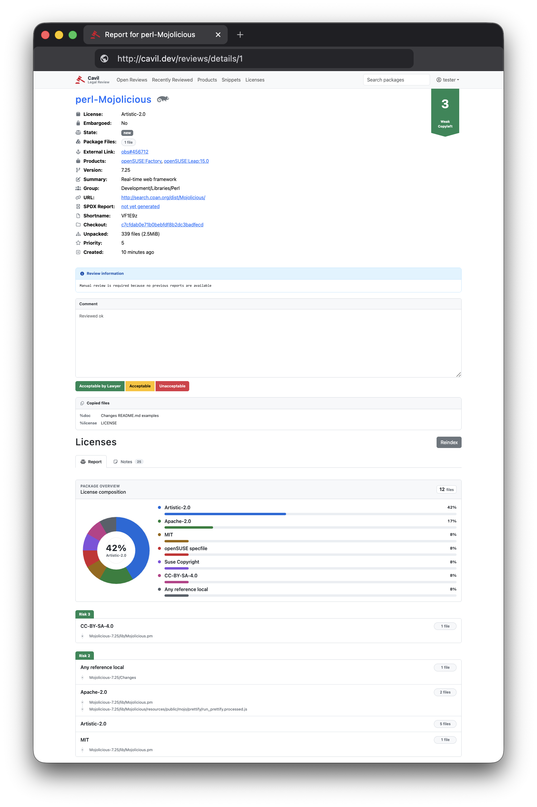

#  

Cavil is a legal review and Software Bill of Materials (SBOM) system. It is used in the development of
openSUSE Tumbleweed, openSUSE Leap, as well as SUSE Linux Enterprise.

**Important**: Note that most of the data used by Cavil has been curated by lawyers, but the generated reports do not
count as legal advice and no guarantees are made for their correctness!

## Features

### Scanning & detection

* Source code legal review for RPMs, DEBs, tarballs and various other package formats
* High performance scanner with recursive decompression of almost any archive format
* 28.000 curated patterns for 2000 license combinations with 500 distinct [SPDX](https://spdx.dev) expressions
* Detection of vendored/bundled subcomponents (npm, Cargo, PyPI, Maven, Go, Composer, NuGet, RubyGems) shipped inside
  packages, surfaced in the SBOM and the review report

### SBOM & compliance

* Software Bill of Materials (SBOM) generation in SPDX 3.0.1 format, for the EU Cyber Resilience Act (CRA) as specified
  by [BSI TR-03183-2](https://www.bsi.bund.de/dok/TR-03183-en), and satisfying the
  [CISA minimum elements](https://www.cisa.gov/sbom) on top of it wherever the two do not conflict - see
  [standards and coverage](docs/Architecture.md#standards-and-coverage) for the four things that are not covered yet,
  and why
* Package and component (purl) search, plus a component export, for supply-chain and vulnerability triage

### Review workflow

* Legal risk assessments by lawyers for every pattern match
* Human reviews with approval/rejection workflow, and optional automatic approvals based on risk
* Machine learning text classification of snippets, which drives Cavil's automated resolution of scanner noise

### Integrations

* [MCP](https://modelcontextprotocol.io/) support for integration into AI assisted
  [legal review workflows](docs/UserAPI.md#agent-skills)
* REST API for integration into existing source code management systems
* [Open Build Service](https://github.com/openSUSE/openSUSE-release-tools) and
  [Gitea](https://github.com/openSUSE/cavil-gitea) integration via bots
* Direct tarball upload, for one-off analysis without any bot integration
* OpenID Connect (OAuth 2.0) authentication

## AI

Cavil relies on a machine learning model for text classification. The pattern matching that identifies clusters of
legal keywords (snippets) has a false-positive rate of about 80%, and the classifier is what tells genuine legal text
apart from that noise. Everything Cavil does with a snippet after that - scoring it against the known licenses, and
automatically folding, clearing or covering it in reports - builds on the classifier's judgement. Even a simple model
identifies almost all of the false positives.

The [openSUSE HuggingFace org](https://huggingface.co/openSUSE) has a collection of models fine-tuned specifically for
this task, such as `Cavil-Qwen3.5-4B`, usually served with a [llama.cpp](https://github.com/ggml-org/llama.cpp) server.
See the [setup guide](docs/Setup.md#5-set-up-the-ai-classifier) for deployment instructions.

## Getting Started

To set up Cavil, follow the [setup guide](docs/Setup.md). Its
[quick start with Docker](docs/Setup.md#quick-start-with-docker) gets you a working instance with a few commands, and
the rest of the guide covers installing directly on a host. Either way, Cavil needs the AI classifier described there.

To work on Cavil itself, the [development guide](docs/Development.md) sets up a local environment with example data.

## Documentation

* [Setup](docs/Setup.md) - setting up a fresh Cavil instance for production.
* [Architecture](docs/Architecture.md) - how the pieces fit together: components, the review workflow, pattern
  matching and SBOM generation.
* [License Pattern Lifecycle](docs/PatternLifecycle.md) - a plain-language guide, written for lawyers and reviewers,
  to how a piece of text becomes a reusable license pattern.

The [documentation index](docs/README.md) has the full list, including the API reference, maintenance tasks and the
contributor workflow.

## Acknowledgements

Cavil bundles and builds upon license data from third parties, including the
[ScanCode LicenseDB](https://scancode-licensedb.aboutcode.org/) (CC-BY-4.0), the
[SPDX License List](https://spdx.org/licenses/), and the
[OSADL Open Source License Compliance Checklists](https://www.osadl.org/checklists) (CC-BY-4.0), whose license
compatibility matrix is surfaced per package in legal reports. See the [NOTICE](NOTICE) file for the full attributions
and their licenses.
